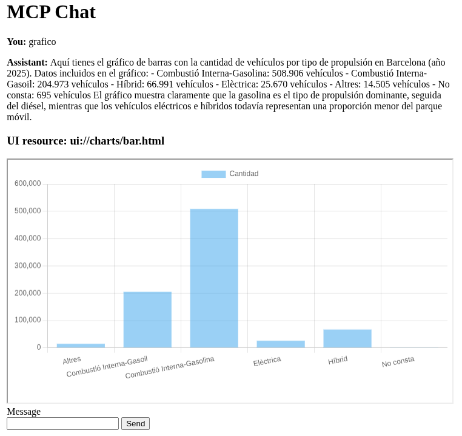

# mcp-moz

A small MCP playground for demoing at MozFest 2026: an MCP server with a UI extension (MCP Apps), and a chat app
that acts as an MCP host — it talks to a chat model, lets the model call the server's
tools, and renders any `ui://` resource (a Chart.js chart) inline in the conversation.

## Components

| Path | What it is |
|---|---|
| `server.py` | MCP server (streamable-http, port 8000) with tools over Barcelona 2025 vehicle data. Includes an MCP Apps extension binding the barchart tool to the `ui://charts/bar.html` Chart.js resource. |
| `app.py` | Starlette chat app (port 8080). Agent loop: Model → MCP tool calls → final reply. UI-bound tool results are returned as artifacts for inline rendering. |
| `index.html` | Chat front end (plain HTML/JS, no CSS). Loads `ui://` resources in sandboxed iframes and delivers tool results via `notifications/call_tool_result`. |
| `vehicles-2025.csv` | Sample data ([Barcelona Open Data](https://opendata-ajuntament.barcelona.cat/data/es/dataset/est_vehicles_propulsio)). |

## Setup

Requires Python 3.14+. Uses [uv](https://docs.astral.sh/uv/):

```bash
uv sync
```

Create a `.env` file (used by the chat app; **add `.env` to `.gitignore`**):

```
API_KEY=<your API key>
AI_MODEL=<your AI MODEL>
AI_BASE_URL=<your AI Base URL>
MCP_SERVER_URL=http://localhost:8000/mcp
```

## Run

```bash
# 1. MCP server (terminal 1)
uv run mcp run --transport streamable-http server.py --port 8000

# 2. Chat app (terminal 2)
uv run uvicorn app:app --port 8080
```

Open http://localhost:8080 and ask for a chart of vehicles by propulsion type —
the model calls the MCP tool and the chart renders in the conversation.

## Screenshot


